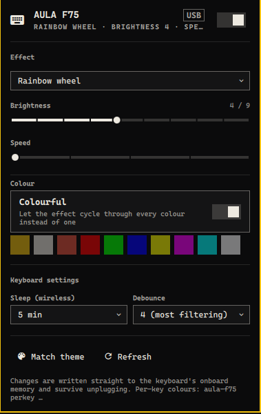

# AULA F75 for Omarchy

Control an [AULA F75](https://www.aulastar.com/) mechanical keyboard from the
Omarchy bar: lighting, OS mode, Win key lock and the lock keys. No vendor
software, no kernel module, no Python packages: a bar widget plus a small
`hidraw` driver written against a protocol reverse engineered from the Windows
driver, USB captures and the board itself.

<p align="center"></p>

## What you get

**Lighting**

- Effect, brightness, speed and colour, with swatches for the current theme's
  accent, text and urgent colours next to the keyboard's own seven.
- Colourful mode (the effect cycles through every colour), lighting on/off.
- **Theme sync** – when enabled, the keyboard is re-coloured every time you
  switch Omarchy themes.

**Keyboard settings**

- **OS mode** – Windows, Android or macOS, shown and switched from the panel.
  This is the same setting the Fn combos change on the board (Fn+Q for
  Android, and so on); holding Fn lights the current mode's key.
- **Win key lock** – what Fn+Win toggles. The panel shows whether the Win key
  is disabled and lets you flip it.
- **Caps / Num / Scroll Lock** – live state read from the keyboard's own
  indicator LEDs, with switches to toggle each one.
- Wireless sleep timer and key debounce.
- **Battery and active link** – which connection the keyboard is on right now
  (USB, 2.4 GHz dongle, Bluetooth), what else is plugged or paired, and the
  battery percentage on the dongle, also as text next to the bar icon.

**Around the bar**

- Mouse shortcuts on the bar icon: left opens the panel, right toggles the
  lighting, middle applies the theme accent, wheel changes brightness. The
  tooltip names the effect and any active mode or lock.
- Keys inside the panel: `T` theme accent, `O` lighting on/off, `R` refresh,
  `W` Win key lock, `M` Windows/macOS, `C`/`N`/`S` Caps/Num/Scroll Lock.
- IPC: `omarchy-shell crucialjun.aula-f75 effect rainbow`, `… brightness 5`,
  `… colour '#ff8800'`, `… theme`, `… lightsToggle`, `… winlock`,
  `… mode mac`, `… lock caps`, `… toggle`.
- A CLI (`bin/aula-f75`) that also does per-key colours, gradients, backup and
  restore of the keyboard's onboard settings, raw protocol access and a
  `watch` mode for finding new settings.

Works over USB (`258a:010c`). The 2.4 GHz dongle (`3554:fa09`) is supported
on a best-effort basis for effect/brightness/speed/colour/sleep; see
[docs/PROTOCOL.md](docs/PROTOCOL.md) for exactly what is verified.

## Install

```bash
omarchy plugin add https://github.com/crucialjun/omarchy-aula-f75.git --enable
```

Then open the panel once and click **Grant access**: it installs a udev rule
(`/etc/udev/rules.d/60-aula-f75.rules`, through polkit) so your user can
talk to the keyboard's vendor HID interface and tap its lock keys through
its event node. Equivalent by hand:

```bash
sudo cp ~/.config/omarchy/plugins/crucialjun.aula-f75/udev/60-aula-f75.rules /etc/udev/rules.d/
sudo udevadm control --reload-rules && sudo udevadm trigger --subsystem-match=hidraw --subsystem-match=input
```

Everything in the panel except the Caps/Num/Scroll switches works with the
HID rule alone; those three need the event-node rule as well, and the panel
says so until it is in place.

Place the widget with `omarchy bar move crucialjun.aula-f75 --section right`
and configure it under **Setup › Plugins** (theme sync, hide when
disconnected, hidden effects, poll interval, battery on the bar, battery
poll interval).

Requirements: Omarchy Quattro or newer (the Quickshell shell with plugins)
and `/usr/bin/python3`, which Omarchy already ships.

## CLI

```bash
P=~/.config/omarchy/plugins/crucialjun.aula-f75/bin/aula-f75
python3 $P status                    # decoded settings block, mode, locks
python3 $P effect rainbow            # by name or id (see: effects)
python3 $P brightness 6              # 0..9
python3 $P speed 2                   # 0..4
python3 $P colour '#ff8800'          # colour of the current effect
python3 $P colorful on               # let the effect cycle colours
python3 $P sleep 10                  # minutes, or off (wireless idle sleep)
python3 $P debounce 2                # 1..4
python3 $P mode mac                  # OS mode: windows | android | mac | toggle
python3 $P winlock off               # Win key lock (Fn+Win): on | off | toggle
python3 $P battery                   # battery percent and the active link
python3 $P locks                     # Caps/Num/Scroll lock state
python3 $P lock caps                 # toggle (or: lock num off, lock scroll on)
python3 $P theme                     # apply the Omarchy theme accent
python3 $P perkey --all '#202020' W=#ff0000 A=#ff0000 S=#ff0000 D=#ff0000
python3 $P perkey --gradient '#ff0080' '#0080ff'
python3 $P backup f75.json --matrix  # onboard lighting + key matrix, restorable
python3 $P --json status             # what the widget consumes
python3 $P watch                     # print settings-block bytes as they change
```

`aula-f75 keys` lists the key names and LED indexes; `aula-f75 effects` the
effects. Every write is a read-modify-write of the keyboard's own 128-byte
settings block, so nothing you did not touch changes.

`aula-f75 watch` is for protocol work: leave it running, press Fn combos on
the board and it prints the offsets that moved (`--matrix` also watches both
key-matrix layers). That is how the Win lock and OS mode bytes were found.
Every `aula-f75` process takes a lock on the keyboard, so `watch`, the CLI
and the bar widget can coexist.

## How it was made

The vendor's `AULA F75 Setup v2.0 20260514.exe` (Inno Setup) was unpacked;
its `OemDrv.exe` (MFC, class `CDevG5KB`) and device profile `KB.ini` were
reverse engineered with strings, Ghidra and published USB captures. The
settings the vendor software never exposes (OS mode, Win key lock) were
located by watching the settings block while pressing the Fn combos on a real
board. The full write-up with evidence is in [docs/PROTOCOL.md](docs/PROTOCOL.md)
and [docs/REVERSING.md](docs/REVERSING.md).

## Development

```bash
python3 -m unittest discover -s tests -v    # protocol tests, no hardware needed
omarchy plugin validate .                   # manifest / entry point checks
qmllint -I "$OMARCHY_PATH/shell" *.qml      # QML against the shell imports
python3 bin/aula-f75 -v --dry-run effect 3  # print the frames instead of sending
```

## Safety

- Only the lighting/settings block (`0x04`), colour table (`0x0a`) and
  per-key table (`0x06`) are written by the widget. The key matrix is touched
  only by `backup --matrix` / `restore --matrix` and `raw`.
- Writes are refused when the block read back from the keyboard lacks the
  `5A A5` signature, unless you pass `--force`.
- One process talks to the keyboard at a time (a lock in
  `$XDG_RUNTIME_DIR`). Two overlapping conversations stall the controller and
  make the kernel re-enumerate the keyboard, which also resets its lighting.
- Caps/Num/Scroll are toggled by tapping the key through the keyboard's own
  event node, so the compositor sees an ordinary key press; nothing is
  injected into other keyboards.
- `aula-f75 backup` before experimenting; `aula-f75 restore` puts it back.
- If the keyboard ever stops answering, unplug and replug it. The SinoWealth
  controller stalls its vendor endpoint on malformed reports.

MIT licensed. Not affiliated with AULA.
